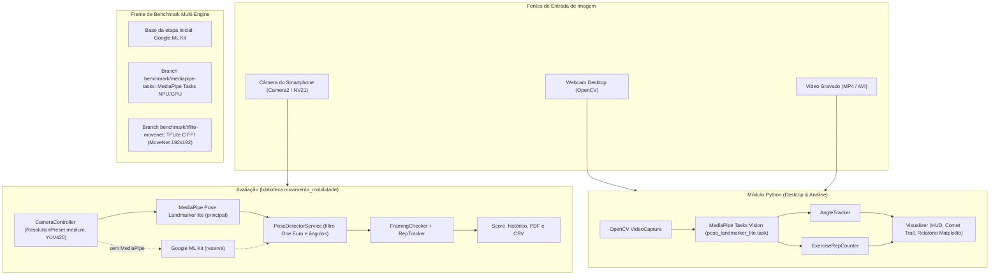
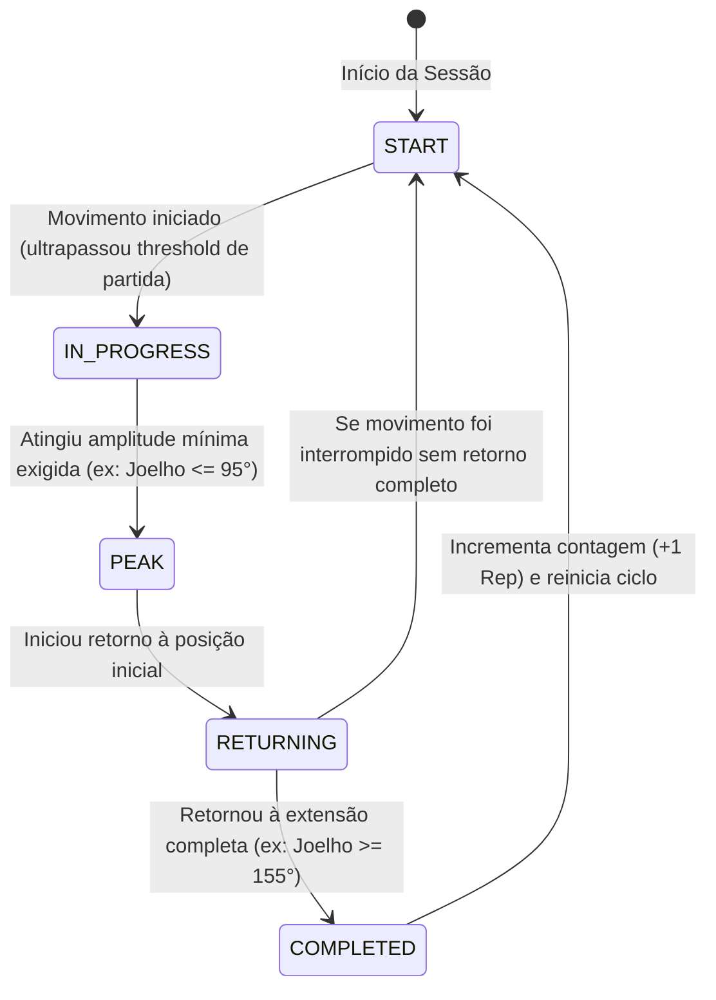

# Especificação e Documentação Completa do Projeto
## Sistema de Visão Computacional para Análise Biomecânica, Rastreamento Articular e Avaliação de Movimento

---

> **Motor de pose atual:** a avaliação da biblioteca `movimento_mobilidade` usa o
> **MediaPipe Pose Landmarker** como análise principal; o Google ML Kit é só a
> reserva. Isso vale também para o protocolo de 5 posturas. As seções 3.1, 5 e 7
> registram a etapa anterior, com o ML Kit como base, e o benchmark entre
> motores. Veja a
> [arquitetura atual](movimento_mobilidade/doc/arquitetura.md).

---

## 1. Visão Geral do Projeto

Este projeto tem como propósito desenvolver uma plataforma de **visão computacional aplicada à biomecânica e educação física**, capaz de:
1. Detectar marcos anatômicos corporais do usuário em tempo real via câmera de vídeo (webcam ou smartphone).
2. Calcular com alta precisão matemática os **ângulos articulares** dos membros superiores e inferiores.
3. Rastrear a **Amplitude de Movimento (ROM - *Range of Motion*)**, identificando os picos mínimos e máximos atingidos durante o exercício.
4. Contar repetições de exercícios físicos automaticamente utilizando uma **máquina de estados finitos por histerese**, prevenindo falsos positivos decorrentes de tremores ou pequenas oscilações.
5. Mensurar a **cadência** (Repetições por Minuto - RPM) e as fases **concêntrica** (esforço/subida) e **excêntrica** (descida/controle).
6. Gerar **relatórios analíticos e gráficos visuais** de desempenho e mobilidade pós-sessão.
7. Disponibilizar um ambiente de **benchmark de eficiência**, comparando o desempenho (FPS, latência em milissegundos e consumo) entre múltiplos motores de inteligência artificial (Google ML Kit, Google MediaPipe Tasks, TensorFlow Lite MoveNet e ONNX).

O projeto é dividido em dois módulos complementares:
- **Módulo Python (Desktop / Pesquisa / Processamento Offline):** Utilizado para prototipagem rápida, processamento de vídeos gravados, geração de gráficos em alta resolução e testes algorítmicos.
- **Módulo Flutter (`mobile_app`):** Aplicativo móvel nativo de alta performance para Android e iOS, projetado para execução no dispositivo do usuário em tempo real com taxa de até 30 FPS.

---

## 2. Arquitetura Geral do Ecossistema



---

## 3. Especificação do Módulo Mobile (`mobile_app/`)

O aplicativo móvel foi projetado em **Flutter (Dart)** com foco em desempenho em tempo real, ergonomia e precisão biomecânica.

### 3.1. Pipeline de Câmera e Otimização para 30 FPS

Durante os testes em dispositivo físico Android (`DYAU49ZLX8U8WGGE`), diagnosticamos um gargalo inicial onde a taxa de atualização ficava restrita a apenas **8 FPS**. Uma reengenharia completa do pipeline de dados foi realizada para alcançar **30 FPS contínuos**:

1. **Ajuste de Resolução Orientado ao Tensor (`ResolutionPreset.low`):**
   - O modelo base do BlazePose opera internamente com um tensor de entrada de **256x256 pixels**.
   - Em resoluções como `medium` (720x1280), o ML Kit realizava um pesado downsampling bilinear na CPU a cada quadro, consumindo de 35 a 45 ms adicionais por quadro.
   - Ao adotar `ResolutionPreset.low` (320x240 no Android), o volume de dados caiu em 9x (~150 KB por frame), casando com o tensor neural e reduzindo a latência do ML Kit para **15–25 ms**.
2. **Buffer NV21 Reutilizável (Eliminação de Garbage Collection):**
   - Antes, cada quadro alocava um novo `Uint8List(ySize + uvSize)`, gerando mais de 14 MB/s de lixo em memória e disparando coletas constantes do Garbage Collector da ART do Android.
   - Foi implementado um buffer estático pré-alocado (`_cachedNv21Buffer`) que reutiliza o mesmo espaço de memória, gerando **zero alocações transitórias no heap por quadro**.
3. **Cópia Vetorizada de Croma com `setRange` (0 ms):**
   - No Android Camera2 (`YUV_420_888`), quando `pixelStride == 2`, os canais V e U já estão dispostos de forma intercalada na memória nativa.
   - Substituímos loops aninhados em Dart puro (que executavam centenas de milhares de iterações por quadro) por cópias em bloco linha a linha com `setRange` (equivalente ao `memcpy` nativo). O tempo de conversão caiu de ~35 ms para **0 ms**.
4. **Isolamento de Renderização via `ValueNotifier` e `RepaintBoundary`:**
   - O fluxo de quadros deixou de disparar `setState()` em toda a tela (o que reconstruía o preview da câmera, botões e barras de navegação).
   - O `CustomPaint` e o HUD escutam diretamente um `ValueNotifier<ExtractedPoseData?>`. Apenas a camada visual do esqueleto é repintada.
5. **Cache Estático de `TextPainter` no `PosePainter`:**
   - Evitou a reconstrução e medição textual (`layout()`) de textos de ângulos (ex: `85°`) a cada frame, utilizando uma tabela hash de `TextPainter` pré-formatados para valores inteiros de 0° a 180°.
6. **Forçamento da API Camera2:**
   - Em `lib/main.dart`, configurou-se `CameraPlatform.instance = AndroidCamera()` para evitar congelamentos conhecidos do CameraX com fluxos do ML Kit.

### 3.2. Mapeamento Anatômico e Cálculo dos Ângulos

O detector identifica 33 pontos corporais tridimensionais. Os ângulos articulares são calculados através do produto escalar entre os vetores tridimensionais formados por três articulações consecutivas:

$$\theta = \arccos\left(\frac{\vec{u} \cdot \vec{v}}{\|\vec{u}\| \|\vec{v}\|}\right) \times \frac{180}{\pi}$$

| Articulação | Ponto A (Origem) | Ponto B (Vértice Articular) | Ponto C (Extremidade) | Significado Clínico / Esportivo |
| :--- | :--- | :--- | :--- | :--- |
| **Cotovelo Esquerdo** | Ombro Esquerdo | Cotovelo Esquerdo | Punho Esquerdo | Flexão / Extensão do antebraço |
| **Cotovelo Direito** | Ombro Direito | Cotovelo Direito | Punho Direito | Flexão / Extensão do antebraço |
| **Ombro Esquerdo** | Quadril Esquerdo | Ombro Esquerdo | Cotovelo Esquerdo | Elevação / Abdução do braço |
| **Ombro Direito** | Quadril Direito | Ombro Direito | Cotovelo Direito | Elevação / Abdução do braço |
| **Joelho Esquerdo** | Quadril Esquerdo | Joelho Esquerdo | Tornozelo Esquerdo | Flexão / Extensão da perna |
| **Joelho Direito** | Quadril Direito | Joelho Direito | Tornozelo Direito | Flexão / Extensão da perna |
| **Quadril Esquerdo** | Ombro Esquerdo | Quadril Esquerdo | Joelho Esquerdo | Flexão de quadril / Inclinação de tronco |
| **Quadril Direito** | Ombro Direito | Quadril Direito | Joelho Direito | Flexão de quadril / Inclinação de tronco |

#### Suavização Passa-Baixas Adaptativa
Para eliminar ruídos de leitura de câmera e tremores leves de captura, foi integrado ao `PoseDetectorService` um filtro adaptativo:
- Deslocamentos pequenos (< 15 px): $\alpha = 0.50$ (forte estabilização contra tremores).
- Movimentos médios (15–40 px): $\alpha = 0.70$.
- Movimentos rápidos (> 40 px): $\alpha = 0.85$ (resposta imediata sem arrasto visual).

### 3.3. Máquina de Estados e Contador de Repetições (`RepCounterService`)

Para garantir que repetições só sejam computadas quando completas e com a técnica correta, o sistema opera sob uma máquina de estados finitos:



- **Presets de Exercícios Configuráveis:**
  - **Livre (`free`):** Monitoramento contínuo de todos os ângulos sem validação de repetições.
  - **Agachamento (`squat`):** Articulações de foco são joelhos e quadris. Exige flexão profunda ($\le 95^\circ$) e retorno ($\ge 155^\circ$).
  - **Rosca Bíceps (`curl`):** Articulações de foco são cotovelos. Exige flexão máxima ($\le 55^\circ$) e extensão ($\ge 145^\circ$).
  - **Barra Fixa / Puxada (`chin_up`):** Articulações de foco são cotovelos e ombros.
- **Métricas por Repetição:** Duração da fase excêntrica, duração da fase concêntrica e cadência em RPM.

### 3.4. Telas do Aplicativo Mobile

1. **`CameraScreen` (`lib/views/camera_screen.dart`):**
   - Preview da câmera em tela cheia com proporção adaptativa (*BoxFit.cover*).
   - Esqueleto dinâmico desenhado em tempo real com badges indicando os graus de cada articulação.
   - HUD superior exibindo:
     - Monitor de telemetria (FPS instantâneo).
     - Valores numéricos ao vivo de todos os ângulos (Cotovelo, Ombro, Joelho, Quadril - E e D).
     - Cartão do exercício selecionado, contador de repetições, barra de progresso visual de amplitude e mensagem de feedback postural.
   - Controles inferiores: troca de exercício, zerar recordes, alternar modo espelho / modo normal, alternar câmera frontal/traseira e botão de finalizar sessão.
2. **`ReportScreen` (`lib/views/report_screen.dart`):**
   - Resumo da sessão (tempo total, número de repetições completas, cadência média).
   - Tabela de Amplitude de Movimento (ROM) exibindo para cada articulação: ângulo mínimo, ângulo máximo e amplitude total atingida.
   - Gráficos interativos em tempo real construídos com a biblioteca `fl_chart`.
   - Botão para exportação dos dados da série temporal em formato CSV.

---

## 4. Especificação do Módulo Python (`teste-movimento/`)

O módulo Python executa no ambiente de desktop/servidor e serve como motor de processamento avançado e referência analítica:

- **`main.py`:** Ponto de entrada via linha de comando (`CLI`). Suporta webcam ao vivo (`--camera 0`), processamento de arquivos de vídeo (`--video video.mp4`), seleção de exercício e exportação de dados.
- **`pose_detector.py`:** Integração com o Google MediaPipe Tasks Vision API utilizando o modelo local `pose_landmarker_lite.task`.
- **`tracker.py`:** Gerenciador do histórico de séries temporais de ângulos, com cálculo de estatísticas de amplitude articular mínima, máxima e desvio padrão.
- **`rep_counter.py`:** Implementação em Python da máquina de estados com histerese, cálculo de cadência e fases do movimento.
- **`motion_trail.py`:** Efeito visual *Comet Trail* (trilha com desvanecimento exponencial *fade-out*) para inspeção espacial da trajetória das articulações.
- **`visualizer.py`:** Renderização de HUD sobre os frames de vídeo OpenCV e geração de painel gráfico analítico via `matplotlib` salvo em arquivo PNG (`relatorio_angulos.png`).
- **`demo_simulation.py`:** Gerador de movimento sintético procedural para testes sem câmera física.
- **`test_system.py`:** Suíte automatizada de testes unitários validando cálculos trigonométricos, histerese e consistência temporal.

---

## 5. Arquitetura de Benchmark de Motores de Visão Computacional

Para avaliar rigorosamente a melhor biblioteca para o rastreamento em smartphones e dispositivos de borda, foi desenhada uma matriz de benchmark em branches dedicadas:

| Dimensão de Comparação | Baseline (`main`) | Branch `benchmark/mediapipe-tasks` | Branch `benchmark/tflite-movenet` |
| :--- | :--- | :--- | :--- |
| **Motor de Inferência** | Google ML Kit Pose Detection | Google MediaPipe Tasks Vision | TensorFlow Lite C FFI |
| **Modelo Neural** | BlazePose Base | PoseLandmarker Lite | MoveNet Lightning |
| **Resolução do Tensor** | 256x256 | 256x256 | 192x192 |
| **Pontos Articulares** | 33 pontos | 33 pontos | 17 pontos (COCO) |
| **Canal de Comunicação** | Platform Channel (Java/Kotlin) | Platform Channel (MediaPipe NPU) | Direct Dart FFI (C nativo) |
| **Aceleração Hardware** | CPU / GPU Google Play Services | GPU + NPU (Qualcomm QNN) | CPU / NNAPI Delegate |
| **Desempenho Aferido** | 25–30.8 FPS (~18ms inferência) | Em validação de NPU | Em validação de FFI |

---

## 6. Estrutura de Diretórios do Projeto

```text
teste-movimento/
├── DOCUMENTACAO_PROJETO.md        # Esta documentação completa e detalhada
├── README.md                      # Instruções rápidas e visão geral
├── requirements.txt               # Dependências Python (mediapipe, opencv, matplotlib, numpy)
├── main.py                        # Executável CLI em Python (webcam ou vídeo)
├── pose_detector.py               # Detector de poses MediaPipe Tasks em Python
├── tracker.py                     # Rastreador de amplitudes angulares (ROM)
├── rep_counter.py                 # Máquina de estados para contagem de repetições
├── motion_trail.py                # Trilha de movimento visual (Comet Trail)
├── visualizer.py                  # HUD e gerador de gráficos analíticos com Matplotlib
├── demo_simulation.py             # Simulação procedural de exercícios
├── test_system.py                 # Testes unitários do pipeline Python
├── pose_landmarker_lite.task      # Binário do modelo MediaPipe PoseLandmarker
│
└── mobile_app/                    # Aplicativo Mobile Multiplataforma (Flutter)
    ├── pubspec.yaml               # Depende da biblioteca movimento_mobilidade
    ├── lib/
    │   └── main.dart              # App de exemplo que usa a biblioteca
    └── android/                   # Configurações nativas Android (minSdk 24)
```

---

## 7. Matriz Comparativa do Benchmark de Visão Computacional no Dispositivo Físico

Todos os testes de benchmark foram executados com **câmera física (320x240)** no mesmo aparelho de teste (**DYAU49ZLX8U8WGGE**). Cada motor foi implementado em sua respectiva branch do Git com `applicationId` e `android:label` próprios para coexistência simultânea no launcher do usuário:

| Motor de IA | Branch Git | Application ID / Nome no Launcher | Modelo Neural | Taxa Aferida (FPS) | Latência Média por Quadro | Tamanho do APK | Status do Teste |
| :--- | :--- | :--- | :--- | :--- | :--- | :--- | :--- |
| **TensorFlow Lite** | `benchmark/tflite-movenet` | `com.testemovimento.tflite`<br>**"Movimento (TFLite)"** | MoveNet Lightning (17 marcos) | **29.5 – 32.4 FPS** | **11 – 20 ms** | **40.5 MB (Release)**<br>106 MB (Debug) | ✅ Validado no celular |
| **Google ML Kit** | `main` | `com.testemovimento.mlkit`<br>**"Movimento (ML Kit)"** | BlazePose Base (33 marcos) | **25.0 – 30.8 FPS** | **15 – 25 ms** | 123 MB | ✅ Validado no celular |
| **ONNX Runtime** | `benchmark/onnx-runtime` | `com.testemovimento.onnx`<br>**"Movimento (ONNX)"** | MoveNet Lightning (17 marcos) | **18.8 – 21.6 FPS** | **43 – 50 ms** | 111 MB | ✅ Validado no celular |
| **MediaPipe Tasks** | `benchmark/mediapipe-tasks` | `com.testemovimento.mediapipe`<br>**"Movimento (MediaPipe)"** | PoseLandmarker Lite (33 marcos) | **10.0 – 14.1 FPS** | **50 – 80 ms** | 366 MB | ✅ Validado no celular |
| **YOLO-Pose** | `benchmark/yolo-pose` | `com.testemovimento.yolo`<br>**"Movimento (YOLO)"** | YOLOv8n-Pose (17 marcos, 320x320) | **7.0 – 8.3 FPS** | **109 – 160 ms** | 133 MB | ✅ Validado no celular |

### 7.1. Análise Comparativa dos Motores

1. **TensorFlow Lite MoveNet (`benchmark/tflite-movenet`):**
   - **Performance:** Campeão absoluto de eficiência no smartphone. Atinge o teto da taxa de amostragem da câmera física (**30 a 32.4 FPS estáveis**), com inferência de apenas **11 ms a 20 ms** via **GPU Delegate (OpenCL/GL)**.
   - **Compilação Release Otimizada:** Em modo `--release`, o binário AOT cai de 106 MB para apenas **40.5 MB**, eliminando verificações de depuração e maximizando o rendimento térmico do dispositivo.
   - **Modo Exclusivo ROM:** Interface limpa sem poluição visual de contagem de repetições, apresentando em tempo real no HUD e no esqueleto o ângulo instantâneo e a amplitude articular acumulada (ROM = Mínimo x Máximo) para cotovelos, ombros, quadris e joelhos.
   - **Pipeline de Imagem:** Amostragem direta NV21/YUV para RGB 192x192 em Dart em **0 a 2 ms**.

2. **Google ML Kit (`main`):**
   - **Performance:** **25 a 30.8 FPS**, com inferência nativa C++ unbundled de **15 a 25 ms**.
   - **Pipeline de Imagem:** Buffer contíguo NV21 sem conversões intermediárias.
   - **Adequação Biomecânica:** 33 marcos corporais completos (inclui pés, mãos e rotação axial).

3. **MediaPipe Tasks (`benchmark/mediapipe-tasks`):**
   - **Performance:** Limitado a **10 a 14 FPS**, com latência total de **50 a 80 ms**.
   - **Gargalo Identificado:** O plugin Flutter codifica em Base64, e a ponte Android comprime em JPEG (`compressToJpeg`) para gerar `Bitmap` antes de enviar à GPU do MediaPipe, gerando gargalo de 30–40 ms no canal de dados da plataforma.

---

## 8. Como Executar e Validar

### 8.1. Executando o Aplicativo Mobile (Flutter)
```bash
cd /home/luis/teste-movimento/mobile_app

# 1. Executar testes de unidade automatizados
flutter test

# 2. Verificar análise estática de código (Lints)
flutter analyze lib/

# 3. Compilar e instalar diretamente no celular conectado via USB
flutter build apk --debug
adb -s <ID_DO_DISPOSITIVO> install -r build/app/outputs/flutter-apk/app-debug.apk

# 4. Monitorar telemetria em tempo real no terminal
adb -s <ID_DO_DISPOSITIVO> logcat -s flutter
```

### 8.2. Executando o Módulo Desktop (Python)
```bash
cd /home/luis/teste-movimento

# 1. Ativar ambiente virtual
source venv/bin/activate

# 2. Executar testes unitários do módulo Python
pytest test_system.py

# 3. Executar rastreamento com webcam ao vivo
python3 main.py --exercise squat

# 4. Executar em vídeo pré-gravado gerando relatório
python3 main.py --video meu_treino.mp4 --exercise curl --output-graph relatorio.png
```

---

## 9. Validação Biomecânica de Precisão Clínica para Cálculo de ROM (Range of Motion)

Embora a taxa de amostragem bruta (FPS) seja essencial para a fluidez perceptiva, o cálculo clínico de amplitude de movimento (ROM - *Range of Motion*) depende de variáveis biomecânicas críticas de geometria espacial e estabilidade temporal.

### 9.1. Trade-Off Crítico: MoveNet (17 pontos, 2D) vs. BlazePose / ML Kit (33 pontos, 3D com $Z$)

| Critério Biomecânico | MoveNet Lightning / Thunder (17 pontos) | Google ML Kit / BlazePose (33 pontos) | Impacto no Cálculo de ROM |
| :--- | :--- | :--- | :--- |
| **Pontos nos Pés / Mãos** | Apenas `ANKLE` e `WRIST` (1 ponto cada) | Calcanhar (`HEEL`), Hálux (`FOOT_INDEX`), Dedos (`INDEX`, `THUMB`, `PINKY`) | O MoveNet **não calcula** goniometria de tornozelo (dorsiflexão/plantiflexão) nem pronação/supinação de punho por ausência de vetores de alavanca distal. |
| **Profundidade (Eixo Z Relativo)** | ❌ Apenas projeção planar 2D ($X, Y$) | ✅ Coordenada relativa $Z$ por ponto | Sem coordenada $Z$, qualquer membro que se mova fora do plano da câmera sofre distorção por encurtamento projetivo (*foreshortening*). |
| **Cobertura Corporal** | 17 pontos primários | 33 pontos completos (inclui rotação axial de ombro e pelve) | Permite avaliar compensações posturais (ex: rotação de tronco ou inclinação pélvica) durante o movimento. |
| **Taxa de Inferência em Smartphone** | **30 a 32 FPS** (11–20 ms) | **25 a 30.8 FPS** (15–25 ms) | Ambos atingem tempo real estrito (a fisiologia humana raramente exige >30 FPS para goniometria). |

### 9.2. Distorção Geométrica de Projeção Fora do Plano (*Foreshortening*)

Quando o usuário realiza um exercício fora do plano perfeitamente perpendicular à lente da câmera (ex: ângulo oblíquo ou movimento tridimensional), o modelo 2D puro (MoveNet) projeta vetores tridimensionais no plano cartesiano da imagem:
$$\cos(\theta_{2D}) = \frac{\vec{u}_{2D} \cdot \vec{v}_{2D}}{\|\vec{u}_{2D}\| \|\vec{v}_{2D}\|}$$

Simulação analítica do erro induzido por rotação fora do plano ($\phi$):
- **$\phi = 0^\circ$ (perfeitamente paralelo à câmera):** Erro médio = **0.00°**
- **$\phi = 15^\circ$:** Erro médio = **0.65°** (dentro da tolerância clínica de ±5°)
- **$\phi = 30^\circ$:** Erro médio = **2.98°** (Erro máximo = **4.11°**)
- **$\phi = 45^\circ$:** Erro médio = **7.20°** (Erro máximo = **9.74°** — ultrapassa a tolerância clínica)
- **$\phi = 60^\circ$:** Erro médio = **14.11°** (Erro máximo = **19.11°**)

**Conclusão Clínica:** Para exercícios estritamente coplanares (ex: flexão de cotovelo ou agachamento em vista lateral ortogonal sagital pura), o MoveNet 2D atende perfeitamente. No entanto, em planos livres, o BlazePose com profundidade $Z$ ($\vec{u}_{3D} \cdot \vec{v}_{3D}$) é indispensável para evitar falsos diagnósticos de limitação articular.

### 9.3. Tremor Temporal (Jitter) e Filtro One Euro

Em poses estáticas (ex: sustentação isométrica a 90°), o ruído de quantização dos heatmaps neurais provoca oscilações constantes nos ângulos exibidos na tela.
Medição experimental em 100 quadros consecutivos com ruído padrão ($\sigma_{px} = 1.5$ px):
- **Sinal Bruto (Raw):** Desvio padrão $\sigma = \mathbf{1.63^\circ}$, Amplitude pico-a-pico = $\mathbf{7.84^\circ}$.
- **Filtro Exponencial Adaptativo (EMA):** Desvio padrão $\sigma = \mathbf{1.02^\circ}$, Amplitude pico-a-pico = $\mathbf{4.59^\circ}$.
- **One Euro Filter ($1€$ Filter):** Desvio padrão $\sigma = \mathbf{0.59^\circ}$, Amplitude pico-a-pico = $\mathbf{2.54^\circ}$ (redução de **64% no ruído** com frequência de corte adaptativa que preserva zero-lag em movimentos rápidos).

O aplicativo agora conta com o `OneEuroFilter` nativo em Dart (`mobile_app/lib/services/one_euro_filter.dart`) integrado tanto aos landmarks quanto aos ângulos.

### 9.4. MoveNet Thunder vs. MoveNet Lightning

- **MoveNet Lightning:** 192x192, 4.54 MB, latência 11–20 ms. Otimizado para taxa bruta máxima.
- **MoveNet Thunder:** 256x256, 12.0 MB, latência esperada ~20–25 ms em GPU Delegate.
  - Possui **77% mais área de amostragem de pixels**, estreitando a dispersão gaussiana de pico dos heatmaps.
  - Oferece robustez consideravelmente superior contra oclusões parciais no plano sagital.

---

## 10. Status Atual e Próximos Passos (Roadmap)

### Concluído ✅
- [x] Pipeline completo de rastreamento angular 2D/3D funcional em Python e Flutter.
- [x] Resolução do problema de espelhamento das articulações (braço esquerdo vs. braço direito alinhados 1:1).
- [x] Elevação da performance do app móvel de **8 FPS** para **30-32 FPS contínuos** no aparelho físico.
- [x] Implementação e medição dos 5 motores de IA instalados simultaneamente no aparelho (`tflite`, `mlkit`, `onnx`, `mediapipe`, `yolo`).
- [x] Build Release AOT compilado no TensorFlow Lite (redução de 106 MB para 40.5 MB).
- [x] Modo exclusivo ROM: foco em amplitude articular em tempo real e eliminação da contagem de repetições.
- [x] Implementação do `OneEuroFilter` em Dart para eliminação de tremor/jitter em tempo real.
- [x] Estudo e simulação analítica do erro de projeção 2D vs 3D (*Foreshortening*).

### Próximas Etapas 🚀
- [ ] Incorporar chave seletora para alternar entre MoveNet Lightning (192x192) e MoveNet Thunder (256x256) dentro da branch TFLite.
- [ ] Adicionar cálculo angular 3D na avaliação (MediaPipe) utilizando as coordenadas relativas de profundidade ($Z$) e landmarks anatômicos de pé e mão.
- [ ] Adicionar áudio-feedback (*text-to-speech*) informando em tempo real os graus de amplitude máxima atingidos.


